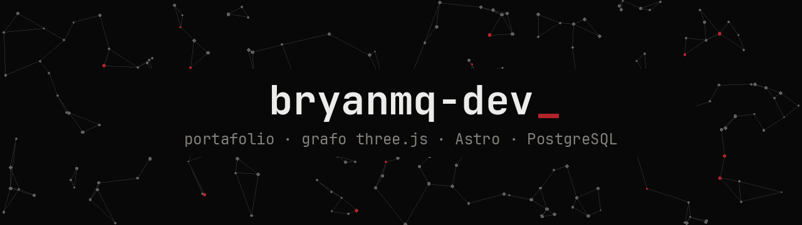
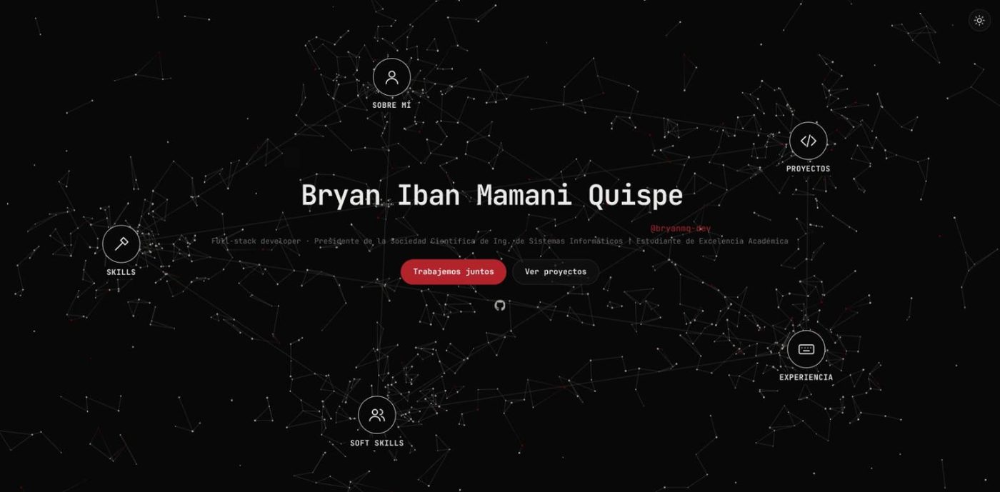
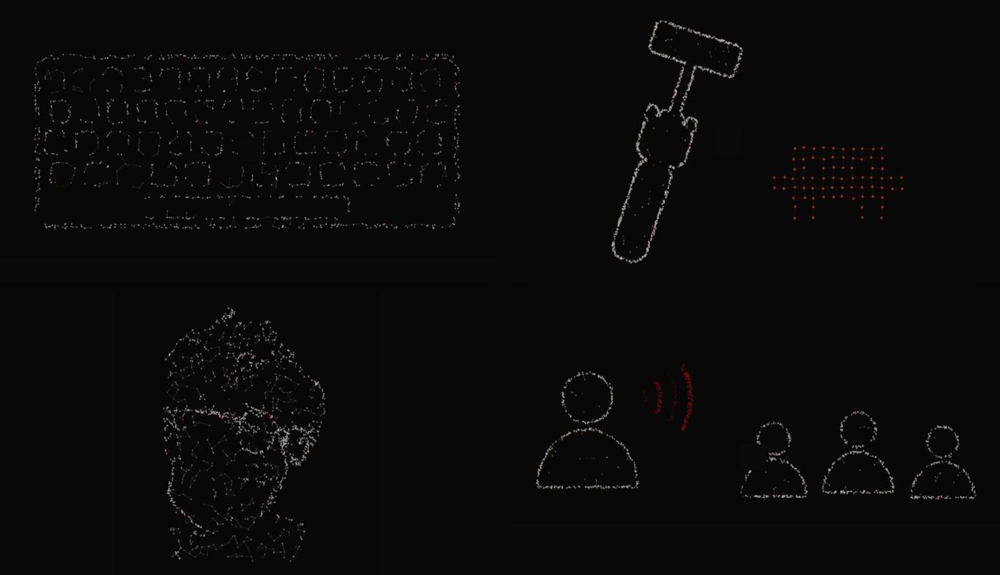
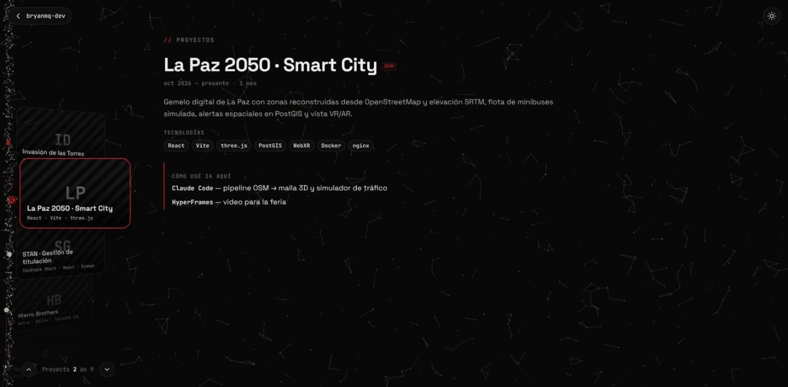
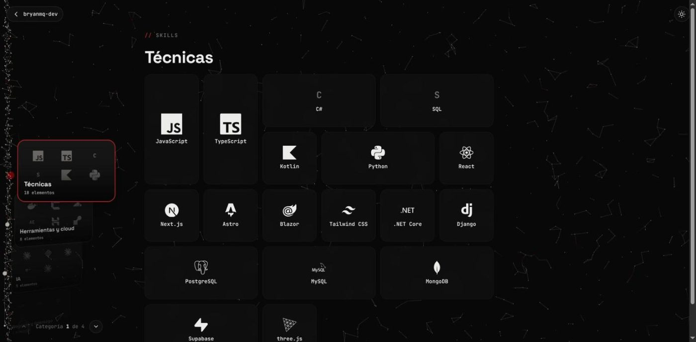
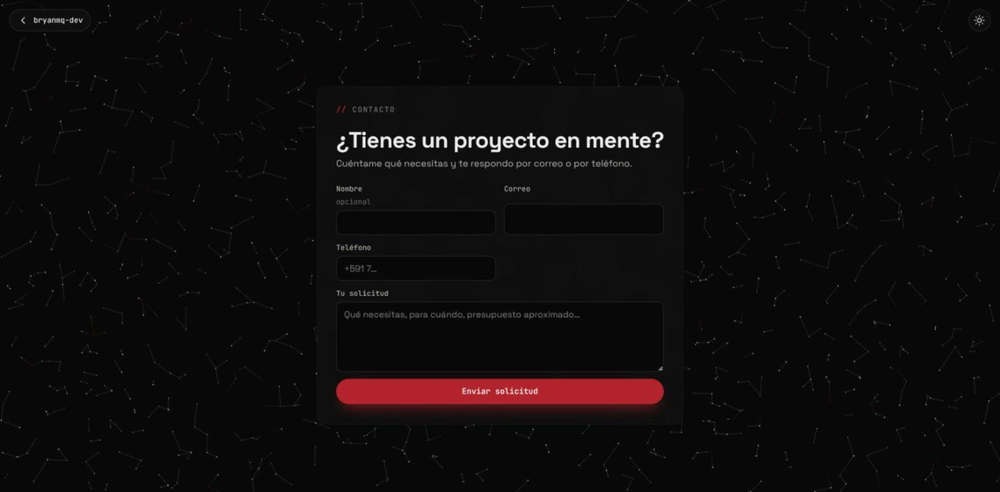
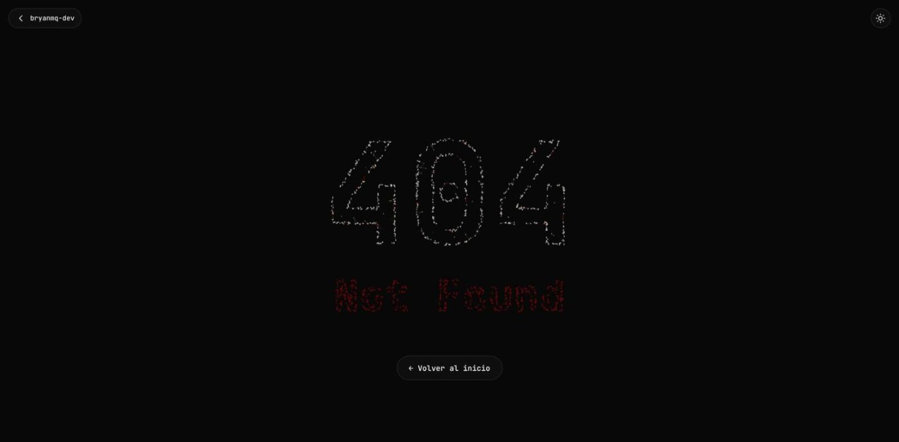
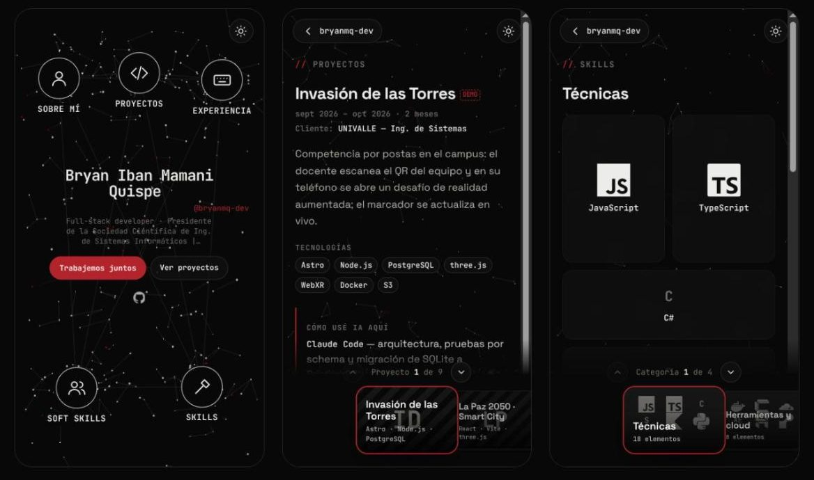
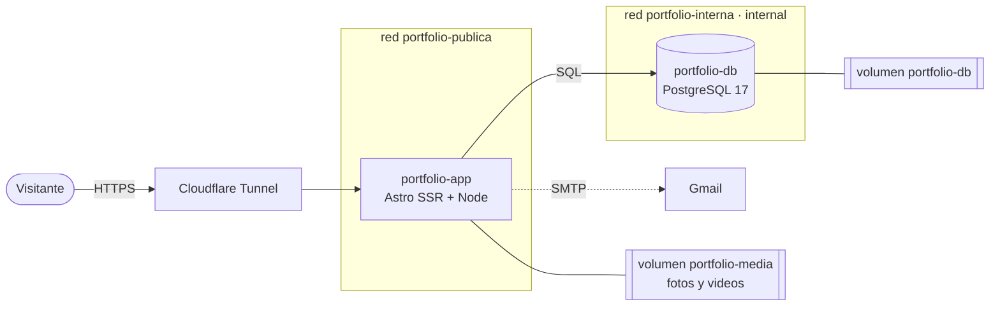

<a id="top"></a>

<div align="center">

<picture>
  <source media="(prefers-color-scheme: dark)" srcset="docs/banner-oscuro.png">
  <source media="(prefers-color-scheme: light)" srcset="docs/banner-claro.png">
  
</picture>

**Bryan Iban Mamani Quispe** · full-stack developer · presidente de la Sociedad Científica de Ing. de Sistemas (UNIVALLE)

[](https://astro.build)
[](https://threejs.org)
[](https://www.postgresql.org)
[](#-desplegar)

[**bryanmq.com**](https://bryanmq.com) · [El grafo](#-el-grafo-es-la-navegación) · [Secciones](#-secciones) · [Admin](#-panel-admin) · [Arquitectura](#-arquitectura) · [Desplegar](#-desplegar) · [Desarrollo](#-desarrollo)

<br>



</div>

<br>

## ◆ El grafo es la navegación

Al entrar, el nombre se escribe letra por letra en medio de un grafo de ~1400 nodos que deriva y esquiva el puntero.
Cada nodo grande es una sección. Al abrirla, **el grafo entero se convierte en una figura durante medio segundo** —una pantalla de carga que se entiende— y después se repliega en la sección.

<div align="center">

</div>

| Sección | El grafo se vuelve… | Y queda como… |
|---|---|---|
| **Sobre mí** | la silueta de mi foto, construida con nodos | la foto real, en el mismo lugar |
| **Proyectos** | — | una pila de tarjetas flotante, unida por la línea del grafo |
| **Experiencia** | un teclado mecánico… que se teclea | un dock de nodos |
| **Soft skills** | una persona hablándole a un grupo (con ondas de voz) | pila de tarjetas de eventos |
| **Skills** | una mano con martillo + el bicho de Claude Code en pixel art | tarjetas por categoría con grilla de logos |
| **404** | el número **404** y *Not Found* en rojo | — |

> [!NOTE]
> Todo el morph corre en la GPU: un solo `THREE.Points` + `LineSegments` con un shader que interpola entre dos disposiciones.
> Cada figura se dibuja en un canvas y se **muestrea a puntos** (contorno + relleno), así cualquier imagen —incluida una foto recortada— puede ser una forma.

<p align="right"><a href="#top">↑ arriba</a></p>

## ◆ Secciones

<table>
  <tr>
    <td width="50%"></td>
    <td width="50%"></td>
  </tr>
  <tr>
    <td><b>Proyectos y eventos</b> — pila de tarjetas al estilo Stage Manager con portada, contador <code>Proyecto n de m</code>, rueda/teclado/deslizar; la línea del grafo se desplaza con ellas. Cada proyecto cuenta <i>cómo usé IA aquí</i>.</td>
    <td><b>Skills</b> — una tarjeta por categoría y una grilla tipo bento con logos de <a href="https://simpleicons.org">simple-icons</a>, que toman el color de su marca al pasar el puntero.</td>
  </tr>
  <tr>
    <td></td>
    <td></td>
  </tr>
  <tr>
    <td><b>Contacto</b> — formulario (correo, teléfono, solicitud) con anti-spam y límite por IP; cada solicitud llega al admin y, si hay SMTP, a mi correo con <i>Responder</i> apuntando al solicitante.</td>
    <td><b>404</b> — el grafo escribe el error y un botón devuelve al inicio con la transición inversa.</td>
  </tr>
</table>

<div align="center">

<br><sub>En móvil: menos nodos, hubs en dos filas y la pila de tarjetas abajo.</sub>
</div>

<p align="right"><a href="#top">↑ arriba</a></p>

## ◆ Panel admin

`/admin`, solo para mí: correo + clave + **código 2FA (TOTP)**, con bloqueo por intentos y códigos de un solo uso.

- **Proyectos · Experiencia · Soft skills** — crear, editar, ocultar y borrar; fotos y videos (se valida el tipo real del archivo), portada, fechas, tecnologías, *cómo usé IA* y **puntos** (más puntos = más arriba).
- **Skills** — por categoría, con el logo resuelto por nombre o por slug de simple-icons.
- **Sobre mí** — biografía en markdown, estudios, enlaces, foto real y silueta (PNG con transparencia) para el grafo.
- **Solicitudes** — lo que llega por el formulario, con contador de nuevas.
- **Correo** — SMTP editable (Gmail + app password); la clave se guarda **cifrada** (AES-256-GCM).
- **Datos demo** — `SEED_DEMO=1` siembra contenido de ejemplo marcado DEMO; un botón lo borra.

<p align="right"><a href="#top">↑ arriba</a></p>

## ◆ Arquitectura

<div align="center">

[](#-arquitectura)

</div>



- **Una sola página SSR** (`src/pages/[...ruta].astro`): todo el contenido se renderiza en el servidor —se indexa y se lee sin JS— y el script solo decide qué se ve y anima el grafo.
- **La base no tiene puertos ni salida a internet**: vive solo en `portfolio-interna` (`internal: true`). La app está en las dos redes.
- **SEO**: `title`/`description` por URL, Open Graph + Twitter, JSON-LD (`Person`, `WebSite`, `BreadcrumbList`, `CreativeWork`), `sitemap.xml` generado desde la base, `robots.txt`, `noindex` en admin y 404.

<details>
<summary><b>Estructura del código</b></summary>

```
src/
  pages/[...ruta].astro   la página pública (inicio, secciones, detalle, 404)
  pages/admin/            panel: entradas, perfil, skills, solicitudes, correo
  pages/api/              contacto (público) y subida de media (admin)
  scene/grafo.ts          escena three.js: puntos, aristas, shader del morph
  scene/formas.ts         layouts (inicio, dock, rail) y figuras dibujadas → puntos
  scene/app.ts            navegación, transiciones, rail, tema, formulario
  db.ts · schema.ts       PostgreSQL (pg) con esquema idempotente
  auth.ts · totp.ts       sesión firmada, CSRF, 2FA
  correo.ts               SMTP con clave cifrada
  seo.ts                  descripciones y datos estructurados
```

</details>

<p align="right"><a href="#top">↑ arriba</a></p>

## ◆ Desplegar

```sh
git clone https://github.com/bryanmq-dev/portfolio.git && cd portfolio
cp .env.example .env            # completa POSTGRES_PASSWORD, SESSION_SECRET y SITE_ORIGIN
docker compose up -d --build    # → http://localhost:4321  (APP_PUERTO lo cambia)
```

Contenedores, volúmenes y redes tienen **nombres fijos**:

| Recurso | Nombre | Notas |
|---|---|---|
| Contenedor app | `portfolio-app` | healthcheck en `/healthz` (verifica la base) |
| Contenedor base | `portfolio-db` | sin puertos publicados |
| Red interna | `portfolio-interna` | `internal: true`: sin salida a internet |
| Red pública | `portfolio-publica` | puerto de la app y salida SMTP |
| Volúmenes | `portfolio-db`, `portfolio-media` | datos y archivos subidos |

Acceso al admin (genera el hash de la clave y el secreto 2FA; escanea el `otpauth://` que imprime):

```sh
docker compose run --rm --no-deps app node scripts/admin-secret.ts tu@correo.com 'una clave de 12+ caracteres'
# o con Node local:  pnpm admin:secret tu@correo.com '…'
```

<details>
<summary><b>Variables de entorno</b></summary>

| Variable | Para qué |
|---|---|
| `POSTGRES_PASSWORD` | clave de la base (obligatoria) |
| `SESSION_SECRET` | firma de sesiones y llave del SMTP cifrado — `openssl rand -hex 32` |
| `SITE_ORIGIN` | `https://bryanmq.com`: canonical, sitemap y verificación de `Origin` |
| `ADMIN_EMAIL` · `ADMIN_PASSWORD_HASH` · `ADMIN_TOTP_SECRET` | acceso al admin (`admin:secret`) |
| `SEED_DEMO` | `1` = contenido de ejemplo la primera vez |
| `SMTP_*` | valores iniciales del correo (lo del admin manda) |
| `GOOGLE_SITE_VERIFICATION` | opcional: meta de verificación de Search Console |
| `APP_PUERTO` | puerto publicado (4321) |

> [!IMPORTANT]
> El TLS termina en el proxy/túnel, por eso Astro tiene `checkOrigin` apagado: el middleware compara `Origin` con `SITE_ORIGIN` y exige CSRF en cada escritura. **`SITE_ORIGIN` tiene que ser la URL pública exacta.**

</details>

<p align="right"><a href="#top">↑ arriba</a></p>

## ◆ Desarrollo

```sh
docker compose -f docker-compose.yml -f docker-compose.dev.yml up -d db   # Postgres en 127.0.0.1:5435
pnpm install
pnpm dev        # http://localhost:4321 · en la consola: await __forma('skills') congela una figura
pnpm test       # node --test contra la base, en un schema temporal por archivo
pnpm check      # tipos
```

<div align="center">
<br>
<sub>Hecho en La Paz, Bolivia · <a href="https://github.com/bryanmq-dev">@bryanmq-dev</a></sub>
</div>
